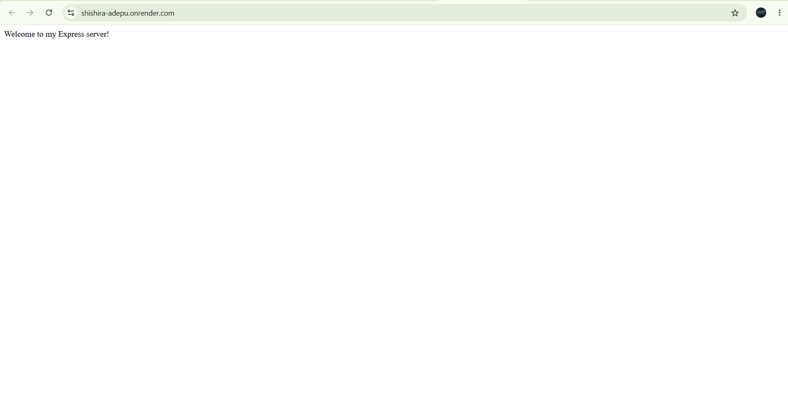
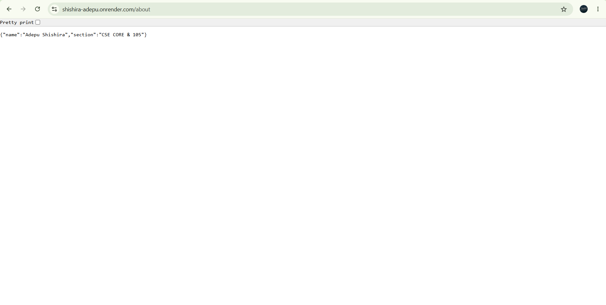
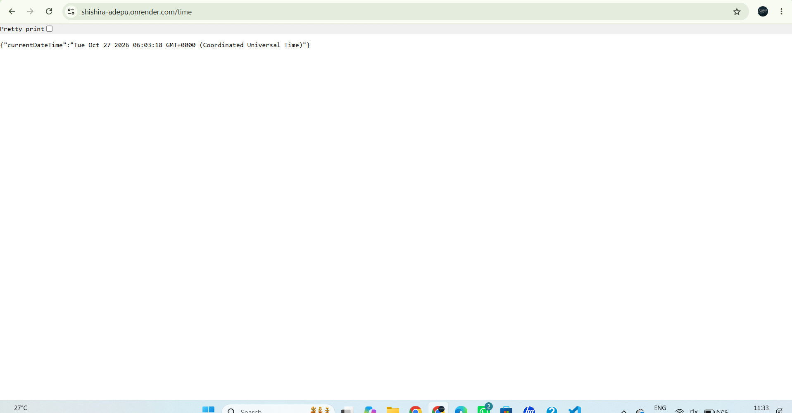
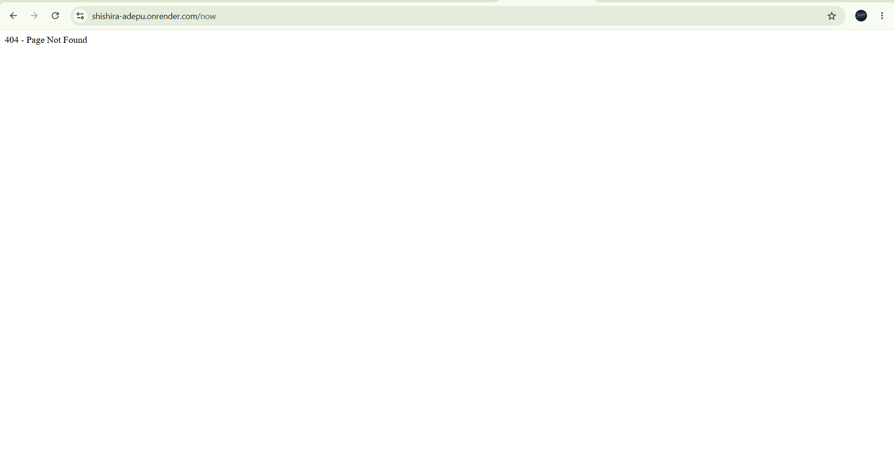

# Lab 1 – Node.js and Express.js Server

**Live Deployment:** https://shishira-adepu.onrender.com/

## Student Details

- **Name:** Adepu Shishira
- **Registration Number:** 252U1R1003
- **Section:** CSE CORE & 105
- **Course:** Backend Development Fundamentals
- **Lab:** Lab 1 – Node.js and Express.js Server

## 1. Project Description

This project demonstrates how to create a basic HTTP server using Node.js and develop a web server using Express.js. It implements routes for displaying a welcome message, student information, the current date and time, and a custom 404 response for unknown routes.

## 2. Technologies Used

- Node.js
- Express.js
- JavaScript
- npm (Node Package Manager)
- Git and GitHub
- Render (Deployment Platform)

## 3. Installation and Execution Steps

### Prerequisites

Install Node.js and npm on your system.

Verify the installation:

```bash
node -v
npm -v
```

### Clone the Repository

```bash
git clone https://github.com/shishiraadepu-crypto/shishira-adepu.git
```

### Navigate to the Project Folder

```bash
cd shishira-adepu
```

### Install Dependencies

```bash
npm install
```

### Start the Server

```bash
node server.js
```

The server will start on port 3000 when running locally.

Open the following URL in your browser:

http://localhost:3000

## 4. API Endpoints

| HTTP Method | Endpoint | Description | Expected Status |
|---|---|---|---|
| GET | `/` | Displays a welcome message | 200 OK |
| GET | `/about` | Returns student information in JSON format | 200 OK |
| GET | `/time` | Returns the current date and time in JSON format | 200 OK |
| GET | `/unknown` | Displays a not-found message for an undefined route | 404 Not Found |

### Endpoint URLs

- **Home:** https://shishira-adepu.onrender.com/
- **About:** https://shishira-adepu.onrender.com/about
- **Time:** https://shishira-adepu.onrender.com/time
- **Unknown Route:** https://shishira-adepu.onrender.com/unknown

## 5. Implementation Details

### Home Route

The home route responds with a welcome message when a user visits `/`.

### About Route

The about route returns student information in JSON format, including the student's name and section.

### Time Route

The time route returns the current date and time using JavaScript's `Date` object.

### 404 Handler

The application handles undefined routes using a custom middleware that responds with a 404 status and a not-found message.

## 6. Screenshots

Screenshots of the deployed application and endpoint responses are included below.

### Home Endpoint



### About Endpoint



### Time Endpoint



### 404 Endpoint



## 7. Deployment

The application is deployed using Render.

**Live URL:** https://shishira-adepu.onrender.com/

The deployed application can be accessed through the public URL without running the server locally. The free hosting service may take some time to respond after a period of inactivity.

## 8. Notes

- The application uses Express.js to define and handle routes.
- JSON responses are used for the `/about` and `/time` endpoints.
- A custom 404 handler manages requests to undefined routes.
- The local server uses port 3000.
- The deployed version is hosted on Render.

## 9. Conclusion

This lab helped demonstrate the fundamentals of Node.js and Express.js, including server creation, route handling, JSON responses, HTTP status codes, error handling, and deployment of a web application using Render.
