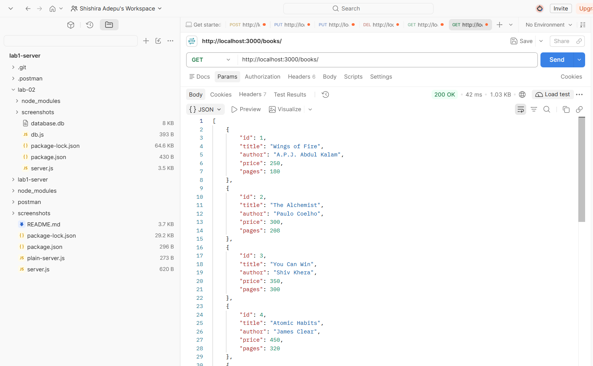
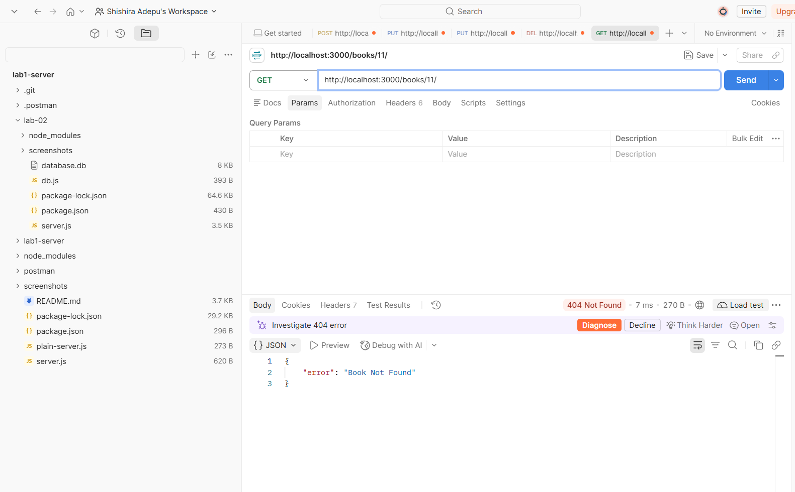
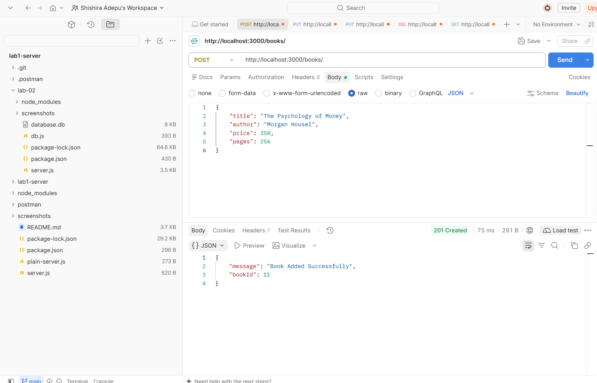
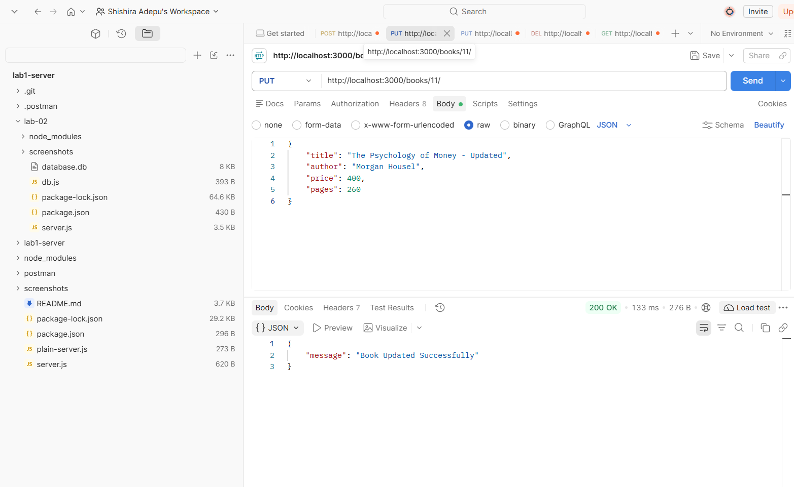
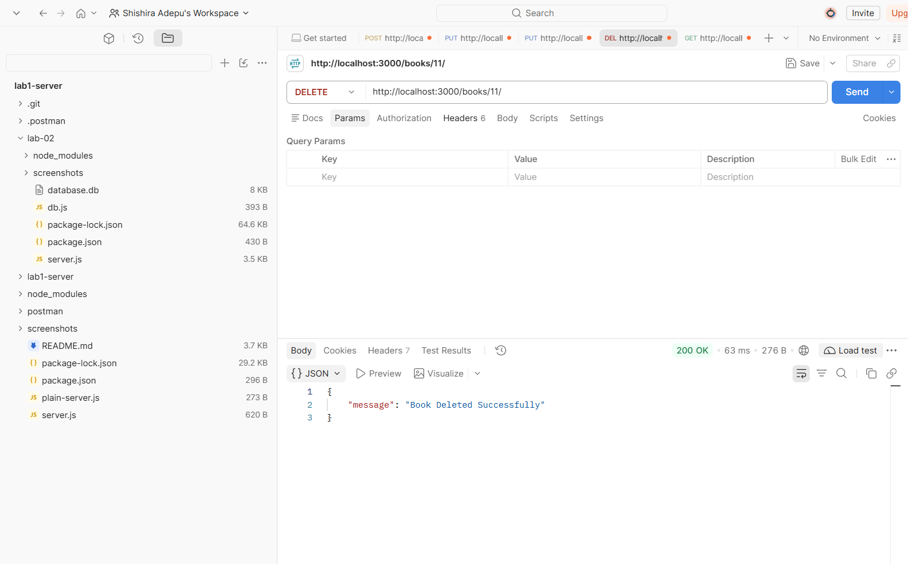
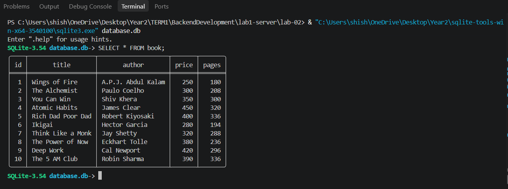

# Backend Development Fundamentals – Lab 02

## SQLite Database and CRUD Routes

##Live Deployment Link 
https://lab-02-sqlite-crud-xx6r.onrender.com/books/?utm_source=chatgpt.com

### 1. Student Details

| Field | Details |
|---|---|
| Name | Shishira Adepu |
| Registration Number | 252U1R1003 |
| Section | BTECH-CSE-2A (223) |
| Course | Backend Development Fundamentals |
| Lab Report | 02 |

### 2. Objective

To connect an Express.js server to an SQLite database and implement CRUD (Create, Read, Update, Delete) operations through HTTP routes.

### 3. Technologies Used

- Node.js
- Express.js
- SQLite
- sqlite
- sqlite3
- Nodemon
- Postman
- JavaScript

### 4. Project Structure

```text
lab-02/
├── screenshots/
│   ├── get-all-books.png
│   ├── get-book-by-id.png
│   ├── post-book.png
│   ├── put-book.png
│   ├── delete-book.png
│   └── database-verification.png
├── database.db
├── db.js
├── server.js
├── package.json
├── package-lock.json
└── README.md
```

### 5. Database Description

Database Name: `database.db`

Table Name: `book`

| Column | Data Type | Description |
|---|---|---|
| id | INTEGER | Primary Key |
| title | TEXT | Book title |
| author | TEXT | Book author |
| price | INTEGER | Book price |
| pages | INTEGER | Number of pages |

Ten sample book records were inserted into the database.

### 6. Installation and Execution

**Prerequisites:** Node.js and npm must be installed.

Navigate to the Lab 2 folder:

```bash
cd lab-02
```

Install dependencies:

```bash
npm install
```

Start the development server:

```bash
npm run dev
```

Expected terminal output:

```text
SQLite database connected successfully!
Server running at http://localhost:3000
```

Base URL:

`http://localhost:3000`

Environment Variables: No environment variables are required for this local project.

### 7. API Endpoints

| HTTP Method | Endpoint | Description |
|---|---|---|
| GET | `/books/` | Retrieve all books |
| GET | `/books/:bookId/` | Retrieve a book by ID |
| POST | `/books/` | Add a new book |
| PUT | `/books/:bookId/` | Update an existing book |
| DELETE | `/books/:bookId/` | Delete a book |

**POST Request Body:**

```json
{
  "title": "Example Book",
  "author": "Example Author",
  "price": 350,
  "pages": 250
}
```

**PUT Request Body:**

```json
{
  "title": "Updated Book Title",
  "author": "Example Author",
  "price": 400,
  "pages": 260
}
```

### 8. SQL Query Handling

Parameterized SQL queries with `?` placeholders are used for user-input values.

Example:

```sql
SELECT * FROM book WHERE id = ?;
```

### 9. API Testing Using Postman

All five endpoints were tested successfully using Postman.

- GET: Retrieved all book records.
- GET by ID: Retrieved an individual book.
- POST: Added a new book.
- PUT: Updated an existing book.
- DELETE: Deleted a book.

The SQLite database was verified using:

```sql
SELECT * FROM book;
```

The verification confirmed that the deleted record was no longer present.

### 10. Screenshots

**GET – All Books**



**GET – Book by ID**



**POST – Add Book**



**PUT – Update Book**



**DELETE – Delete Book**



**SQLite Database Verification**



### 11. Deployment

The application was executed and tested locally at `http://localhost:3000`.

A public deployment URL is not available for this submission. Postman screenshots are provided as evidence of endpoint testing.

### 12. Conclusion

This lab demonstrates the integration of an Express.js application with an SQLite database.

All five CRUD operations were implemented and tested successfully using Postman. Database changes were verified directly through the SQLite command-line interface.

This lab provided practical experience in backend development, database connectivity, SQL queries, HTTP methods, and API testing.
